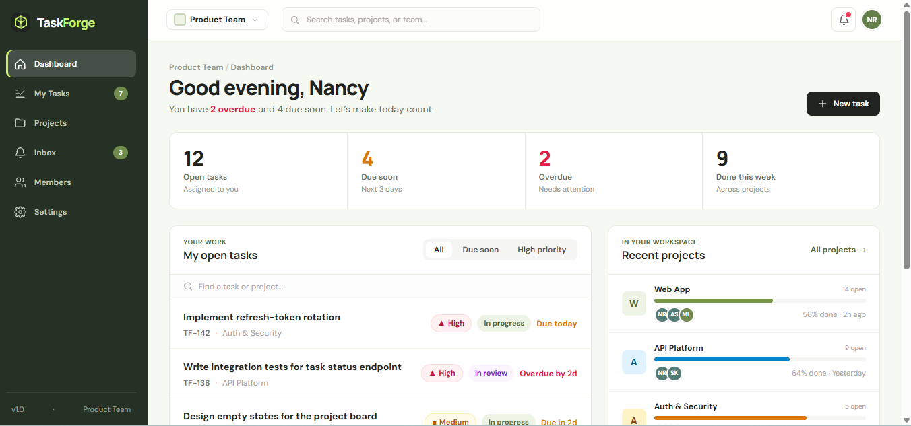

# TaskForge Frontend

TaskForge is a responsive project and task management frontend built with React and Vite.

## Interface preview



*Dashboard view from the TaskForge interface.*

## Main views and interactions

- **Landing page:** introduces TaskForge and links into the workspace.
- **Dashboard:** summarizes work and links to the main workspace views.
- **My Tasks:** lets the user review and create tasks.
- **Projects and project board:** shows project work in board and list views and opens task details.
- **Inbox:** supports searching, filtering, and marking notifications read or unread.
- **Members and settings:** provides example team and workspace screens.
- Navigation uses browser history, so the browser Back and Forward buttons move between app views.

The interface is a frontend prototype. It uses sample data and local UI state; a TaskForge backend API and real authentication are not connected yet. Inbox notification changes are saved in browser local storage.

## Development process

1. Set up the React application with Vite and configured the shared color and typography styles.
2. Built the landing page and defined the path from the landing page into the workspace.
3. Created reusable navigation, icon, avatar, and application-shell components.
4. Added the dashboard, task, project, inbox, members, and settings views.
5. Connected the views with React state, browser history, forms, filters, and notification controls.
6. Used sample data to demonstrate the interface without requiring a backend service.
7. Created a production build with `npm run build`.

## Design patterns and libraries

- **React 18** and **React DOM** build the interface from reusable components.
- **Component-based design:** shared pieces such as `AppShell`, icons, and avatars are reused across screens.
- **Props and state:** parent views pass data and event handlers to components; React state controls local interactions.
- **Browser History API:** `src/App.jsx` switches between app views and supports Back and Forward navigation.
- **Vite 8** provides the development server and production build.
- **Tailwind CSS 3** and regular CSS provide responsive layout, colors, and component styling.
- No routing, UI, or backend library is required beyond the listed packages.

## Run locally

### Requirements

- Node.js `20.19+` or `22.12+`
- npm (included with Node.js)

### Start the development server

1. Open a terminal in the TaskForge project folder.
2. Install dependencies:

   ```bash
   npm install
   ```

3. Start Vite:

   ```bash
   npm run dev
   ```

4. Open the local URL printed in the terminal, usually `http://localhost:5173/`.

### Create and preview a production build

```bash
npm run build
npm run preview
```

Vite writes the production files to `dist/`. The `dist/` folder is generated and is not needed in the source ZIP.

## Project structure

```text
TaskForge/
├── docs/screenshots/       # README preview images
├── src/
│   ├── components/         # Reusable UI and page components
│   ├── data/tasks.js       # Sample task and team data
│   ├── App.jsx             # View navigation and app-level state
│   ├── main.jsx            # React entry point
│   └── styles.css          # Shared theme and base styles
├── index.html              # Vite HTML entry page
├── package.json            # Scripts and dependencies
└── README.md               # Project overview and setup instructions
```
